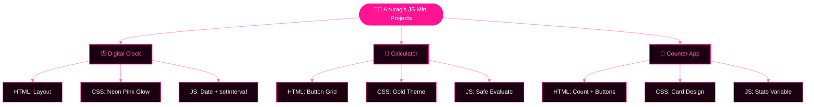
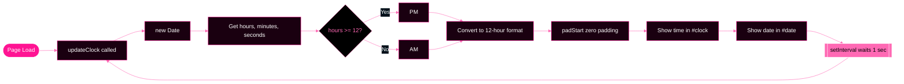
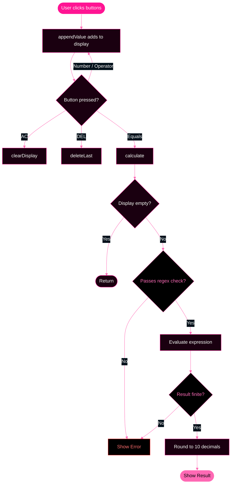
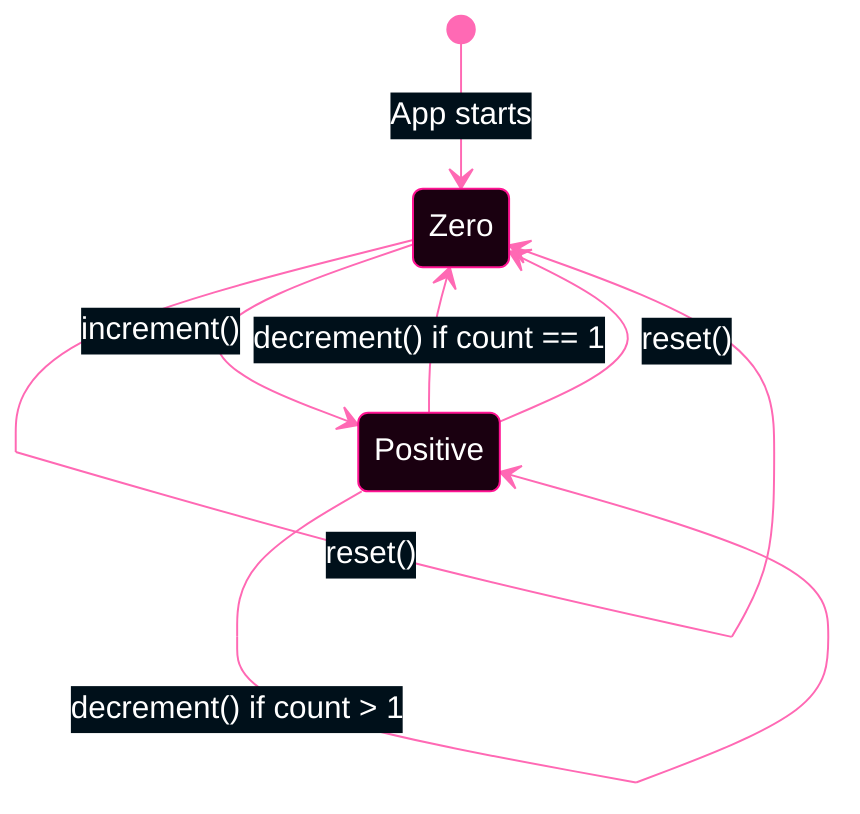

<div align="center">


<br/>


</div>

---

## 💗 About This Repository

Hey! Main **Anurag Prajapati** hoon 👋

Ye repository mere **3 beginner-friendly JavaScript projects** ka collection hai. Teeno projects **bina kisi framework ya library ke**, sirf **HTML, CSS aur JavaScript** se banaye gaye hain. Har project ek single `.html` file hai, bas open karo aur chalao! 🚀

> 🖤 *"Small projects, big learning."* — Anurag

---

## 📑 Table of Contents

- [Projects Overview](#-projects-overview)
- [Project Architecture](#-project-architecture)
- [1. Digital Clock](#-1-digital-clock)
- [2. Calculator](#-2-calculator)
- [3. Counter App](#-3-counter-app)
- [Folder Structure](#-folder-structure)
- [How to Run](#-how-to-run)
- [Tech Stack](#-tech-stack)
- [What I Learned](#-what-i-learned)
- [Future Improvements](#-future-improvements)
- [About the Author](#-about-the-author)

---

## 🎀 Projects Overview

| # | Project | Description | Theme | File |
|:-:|:--------|:------------|:-----:|:-----|
| 1 | 🕒 **Digital Clock** | Live 12-hour clock with AM/PM and full date | 💗 Pink & Black | `DIGITALCLOCK.html` |
| 2 | 🧮 **Calculator** | Basic calculator with safe expression evaluation | 🌟 Gold & Black | `CALCULATOR.html` |
| 3 | 🔢 **Counter App** | Increment, decrement and reset counter | 🌟 Gold & Black | `COUNTER.html` |

---

## 🧩 Project Architecture

Teeno projects ek hi simple pattern follow karte hain: **HTML (structure) → CSS (style) → JavaScript (logic)**.



---

## 🕒 1. Digital Clock

<div align="center">


</div>

Ek **neon pink glow** wala live digital clock jo har second update hota hai aur current date bhi dikhata hai.

### ✨ Features

- ⏱️ Live time update **har 1 second** me
- 🌗 **24-hour → 12-hour** format conversion
- 🔤 **AM / PM** indicator
- 0️⃣ Single digit ke aage **zero padding** (`07:05:09`)
- 📅 Full date, **Indian format** (`en-IN`) me, jaise: *Wednesday, 25 November 2026*
- 💗 Pink **neon glow** text-shadow effect
- 📱 Responsive viewport support

### 🔄 How It Works



### 💡 Code Highlight

```javascript
let period = hours >= 12 ? "PM" : "AM";
hours = hours % 12;
if (hours === 0) hours = 12;

hours = String(hours).padStart(2, '0');
```

---

## 🧮 2. Calculator

<div align="center">


</div>

Ek stylish **gold & black calculator** jo basic arithmetic operations perform karta hai, aur **input validation** ke saath safe hai.

### ✨ Features

- ➕ ➖ ✖️ ➗ Addition, Subtraction, Multiplication, Division
- ⚡ **Percentage (%)** support
- 🧹 **AC** button: poora display clear
- ⌫ **DEL** button: last character delete
- 0️⃣ **00** button aur decimal point support
- 🛡️ **Regex validation**: sirf valid calculator characters allowed
- ❌ Invalid ya infinite result par **"Error"** message
- 🔢 Floating-point fix: `toFixed(10)` se clean result (e.g. `0.1 + 0.2 = 0.3`)

### 🔄 How It Works



### 💡 Code Highlight

```javascript
// Only valid calculator characters are allowed
if (!/^[0-9+\-*/%.() ]+$/.test(expression)) {
    throw new Error("Invalid");
}
```

---

## 🔢 3. Counter App

<div align="center">


</div>

Ek simple lekin powerful **counter application** jo JavaScript me **state management** ka basic concept samjhata hai.

### ✨ Features

- ➕ **Increment**: count badhao
- ➖ **Decrement**: count ghatao
- 🔄 **Reset**: wapas `0` par
- 🚫 Count **0 se neeche nahi jaata** (negative protection)
- 🎨 Clean card UI with glowing box-shadow

### 🔄 State Diagram



### 💡 Code Highlight

```javascript
function decrement() {
    if (count > 0) {   // negative protection
        count--;
        display.innerText = count;
    }
}
```

---

## 📂 Folder Structure

```bash
📦 anurag-js-mini-projects
 ┣ 📜 DIGITALCLOCK.html   # 🕒 Live Digital Clock
 ┣ 📜 CALCULATOR.html     # 🧮 Basic Calculator
 ┣ 📜 COUNTER.html        # 🔢 Counter App
 ┗ 📜 README.md           # 📖 You are here
```

---

## 🚀 How to Run

**Option 1: Direct (Sabse easy)**

1. Repository **download** ya **clone** karo
2. Jo project chalana hai, uski `.html` file par **double-click** karo
3. Browser me khul jayega, bas enjoy karo! 🎉

**Option 2: Git Clone**

```bash
git clone https://github.com/YOUR_USERNAME/YOUR_REPO_NAME.git
cd YOUR_REPO_NAME
```

Phir kisi bhi `.html` file ko browser me open karo.

**Option 3: VS Code Live Server**

1. VS Code me folder open karo
2. **Live Server** extension install karo
3. File par right-click → **Open with Live Server**

---

## 🛠️ Tech Stack

<div align="center">

| Technology | Use |
|:----------:|:----|
|  | Structure of pages |
|  | Styling, Flexbox, Grid, gradients, glow effects |
|  | Logic, DOM manipulation, timers |

</div>

---

## 📚 What I Learned

- 🎯 **DOM Manipulation**: `getElementById`, `innerText`
- ⏰ **Timers**: `setInterval()` se live updates
- 📅 **Date API** aur `toLocaleDateString()` formatting
- 🧠 **State management** with simple variables
- 🛡️ **Input validation** using Regular Expressions
- 🎨 **CSS**: Flexbox, Grid, gradients, `box-shadow`, `text-shadow`
- 🐛 **Edge cases**: negative count, empty input, invalid expressions

---

## 🔮 Future Improvements

- [ ] 🌙 Dark / Light theme toggle
- [ ] ⌨️ Keyboard support in Calculator
- [ ] 🕰️ 12h / 24h format switch in Clock
- [ ] 🌍 Multiple timezone support
- [ ] 💾 Counter value ko `localStorage` me save karna
- [ ] 📜 Calculator history feature
- [ ] 🔊 Sound effects on button click

---

## 👨‍💻 About the Author

<div align="center">


**Anurag Prajapati**

> 💗 Passionate beginner developer jo HTML, CSS aur JavaScript se creative projects banana pasand karta hai.

[](https://github.com/YOUR_USERNAME)
[](https://linkedin.com/in/YOUR_LINKEDIN)
[](mailto:YOUR_EMAIL@gmail.com)

</div>

---

## ⭐ Show Your Support

Agar ye projects pasand aaye ho to:

- ⭐ Repository ko **Star** karo
- 🍴 **Fork** karke apna version banao
- 📢 Doston ke saath **share** karo

---

<div align="center">

**Made with 💗 and ☕ by [Anurag Prajapati](https://github.com/YOUR_USERNAME)**


</div>
