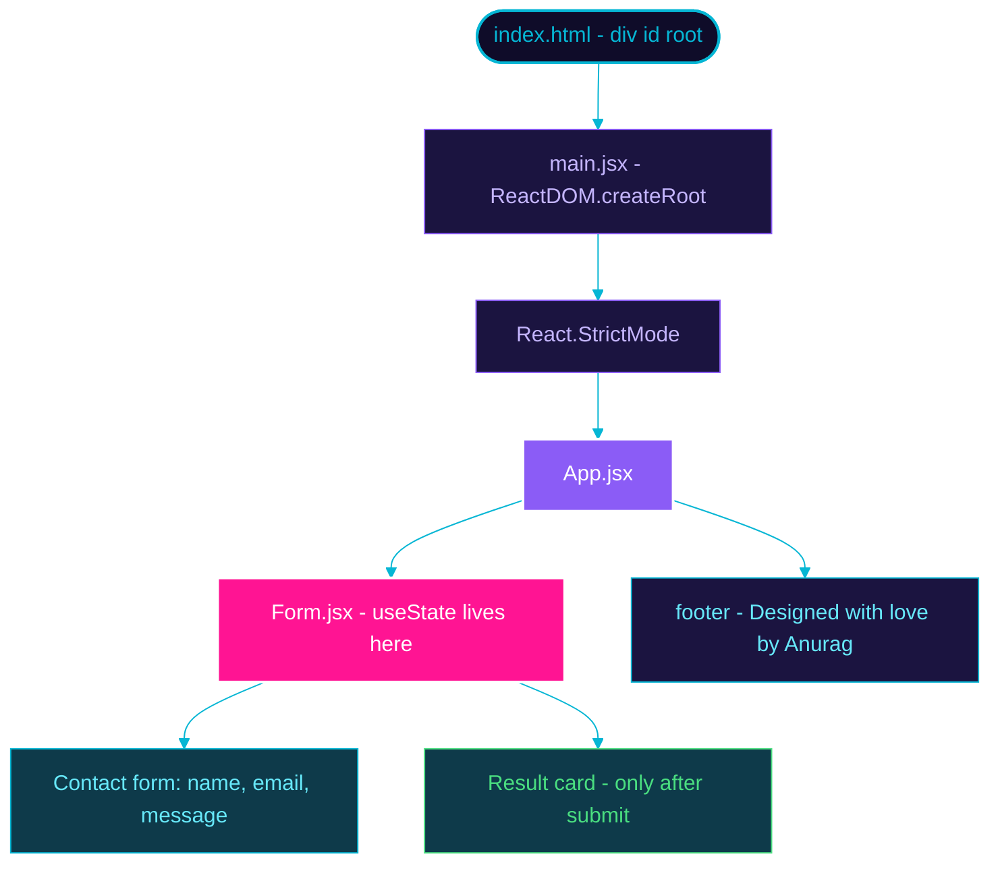
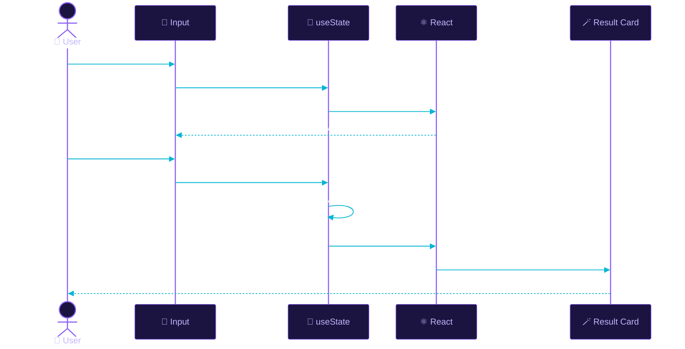
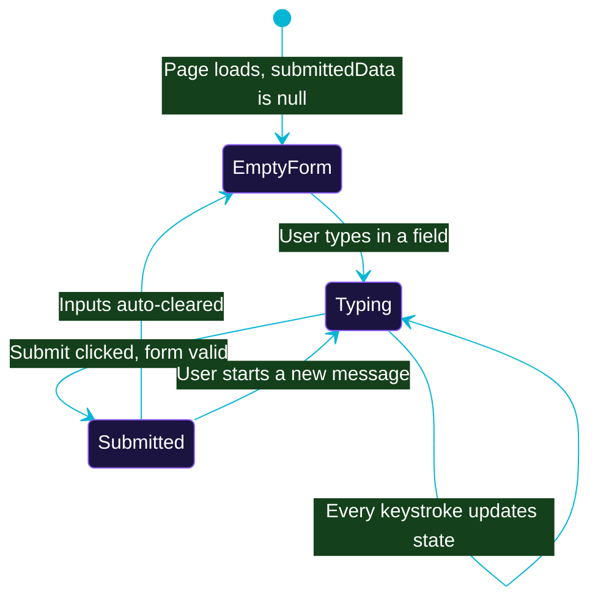

<div align="center">


<br/>


</div>

---

## 💜 About This Task

Hey! Main **Anurag Prajapati** hoon 👋

Ye **Task 14** hai meri React learning journey ka. Isme maine ek **Contact Us form** banaya hai jo **`useState` Hook** se kaam karta hai. User jo bhi type karta hai wo React ki **state** me save hota hai, aur **Submit** karne par screen par **Submitted Details** card dikhta hai.

> 💙 *"State change hoti hai, React screen khud update kar deta hai."* — Anurag

---

## 📑 Table of Contents

- [Features](#-features)
- [Component Structure](#-component-structure)
- [State Variables](#-state-variables)
- [How It Works](#-how-it-works)
- [Code Highlights](#-code-highlights)
- [Folder Structure](#-folder-structure)
- [How to Run](#-how-to-run)
- [Concepts Used](#-concepts-used)
- [What I Learned](#-what-i-learned)
- [Future Improvements](#-future-improvements)
- [About the Author](#-about-the-author)

---

## ✨ Features

| | Feature | Detail |
|:-:|:--------|:-------|
| 📝 | **Contact Form** | Name, Email aur Message ke 3 fields |
| 🎛️ | **Controlled Inputs** | Har input ki value React state se control hoti hai |
| ⚡ | **Live State Update** | Har key dabane par state turant update |
| ✅ | **Built-in Validation** | `required` aur `type="email"` se khali ya galat email nahi jayega |
| 🚫 | **No Page Reload** | `e.preventDefault()` se form refresh nahi hota |
| 🧹 | **Auto Reset** | Submit ke baad teeno fields khali ho jate hain |
| 🪄 | **Conditional Rendering** | Submit ke baad hi **Submitted Details** card dikhta hai |
| 💜 | **Neon Styled UI** | Custom CSS ke saath modern look |

---

## 🧩 Component Structure



---

## 🗃️ State Variables

`Form.jsx` ke andar **4 state variables** hain:

| State | Setter | Initial Value | Kaam |
|:------|:-------|:-------------:|:-----|
| `name` | `setName` | `""` | Name input ki value |
| `email` | `setEmail` | `""` | Email input ki value |
| `message` | `setMessage` | `""` | Message textarea ki value |
| `submittedData` | `setSubmittedData` | `null` | Submit ke baad ka data (card dikhane ke liye) |

---

## 🔄 How It Works

### 1️⃣ Poora Data Flow

```mermaid
%%{init: {'theme':'base','themeVariables':{'primaryColor':'#1b1440','primaryTextColor':'#ffffff','primaryBorderColor':'#8b5cf6','lineColor':'#06b6d4','fontFamily':'Arial'}}}%%
flowchart LR
    A(["User types in input"]) --> B["onChange fires"]
    B --> C["setName / setEmail / setMessage"]
    C --> D["State updates"]
    D --> E["React re-renders Form"]
    E --> F["Input shows new value"]
    F --> A
    F --> G(["User clicks Submit"])
    G --> H["handleSubmit runs"]
    H --> I["e.preventDefault - no reload"]
    I --> J["setSubmittedData with name, email, message"]
    J --> K["Clear all 3 inputs"]
    K --> L(["Result card appears"])

    style A fill:#8b5cf6,stroke:#fff,color:#fff
    style G fill:#ff1493,stroke:#fff,color:#fff
    style L fill:#0f3d24,stroke:#4ade80,color:#4ade80,stroke-width:2px
    style I fill:#0e3a4a,stroke:#06b6d4,color:#67e8f9
```



### 2️⃣ Sequence Diagram



### 3️⃣ Form States



---

## 💡 Code Highlights

### 🧠 useState Se State Banana

```jsx
const [name, setName] = useState("");
const [email, setEmail] = useState("");
const [message, setMessage] = useState("");
const [submittedData, setSubmittedData] = useState(null);
```

### 🎛️ Controlled Input (value + onChange)

```jsx
<input
    type="text"
    value={name}
    onChange={(e) => setName(e.target.value)}
    required
/>
```

### 🚫 Form Submit Handle Karna

```jsx
const handleSubmit = (e) => {
    e.preventDefault();                       // page reload roko

    setSubmittedData({ name, email, message }); // data save karo

    setName("");                              // inputs khali karo
    setEmail("");
    setMessage("");
};
```

### 🪄 Conditional Rendering

```jsx
{submittedData && (
    <div className="result">
        <h2>Submitted Details</h2>
        <p><b>Name:</b> {submittedData.name}</p>
    </div>
)}
```

---

## 📂 Folder Structure

```bash
📦 task-14-react-usestate
 ┣ 📂 src
 ┃ ┣ 📜 main.jsx     # ⚛️ App ko root me render karta hai
 ┃ ┣ 📜 App.jsx      # 🏠 Form + footer
 ┃ ┣ 📜 Form.jsx     # 📝 useState wala contact form
 ┃ ┗ 📜 App.css      # 🎨 Styling
 ┣ 📜 index.html
 ┣ 📜 package.json
 ┗ 📜 README.md      # 📖 You are here
```

---

## 🚀 How to Run

```bash
# 1. Repository clone karo
git clone https://github.com/YOUR_USERNAME/YOUR_REPO_NAME.git

# 2. Project folder me jao
cd task-14-react-usestate

# 3. Dependencies install karo
npm install

# 4. Project chalao
npm run dev
```

Terminal me jo link aaye (jaise `http://localhost:5173`), use browser me open karo. 🎉

---

## 🧠 Concepts Used

| Concept | Kahan use hua |
|:--------|:--------------|
| `useState` Hook | Name, email, message aur submittedData ki state |
| Controlled Components | `value={name}` + `onChange` |
| Event Handling | `onChange`, `onSubmit` |
| `e.preventDefault()` | Form submit par page reload rokna |
| Conditional Rendering | `{submittedData && (...)}` |
| JSX | HTML jaisa code JavaScript ke andar |
| Components | `App` aur `Form` alag components |
| Import / Export | `export default Form` |
| `React.StrictMode` | Development me extra checks |
| HTML5 Validation | `required`, `type="email"` |

---

## 📚 What I Learned

- ⚛️ **State** kya hoti hai aur **`useState`** kaise kaam karta hai
- 🎛️ **Controlled input** me value React ke paas hoti hai, browser ke paas nahi
- 🔁 State badalte hi React **component ko dobara render** karta hai
- 🚫 `preventDefault()` kyun zaroori hai
- 🪄 `&&` se **conditional rendering** kaise hoti hai
- 🧹 Form submit ke baad state ko **reset** kaise karte hain
- 🧩 Ek bade UI ko chhote **components** me todna

---

## 🔮 Future Improvements

- [ ] ✅ Custom validation messages
- [ ] 🔢 Message ke liye character counter
- [ ] 📦 Teeno states ko ek **object state** me jodna
- [ ] 💾 Submitted data `localStorage` me save karna
- [ ] 🌐 Backend ya API se data bhejna
- [ ] 🎉 Submit hone par success animation
- [ ] 📜 Saare messages ki list dikhana

---

## 👨‍💻 About the Author

<div align="center">


**Anurag Prajapati**

> 💜 Passionate beginner developer jo React aur modern web development seekh raha hai.

[](https://github.com/YOUR_USERNAME)
[](https://linkedin.com/in/YOUR_LINKEDIN)
[](mailto:YOUR_EMAIL@gmail.com)

</div>

---

## ⭐ Show Your Support

- ⭐ Repository ko **Star** karo
- 🍴 **Fork** karke apna version banao
- 📢 Doston ke saath **share** karo

---

<div align="center">

**Designed with 💜 by [Anurag Prajapati](https://github.com/YOUR_USERNAME)**


</div>
