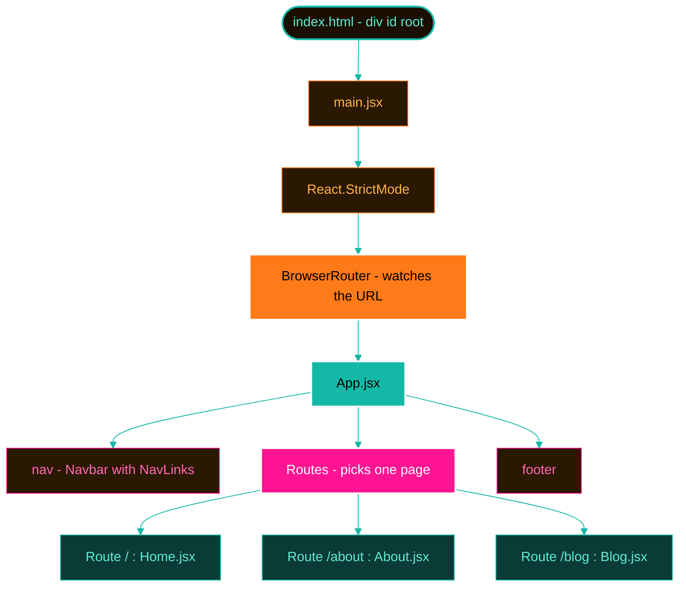
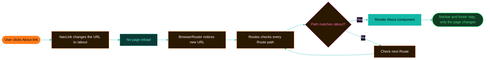
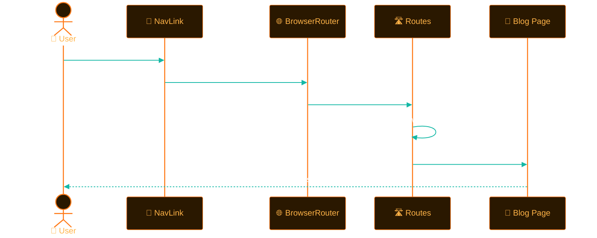
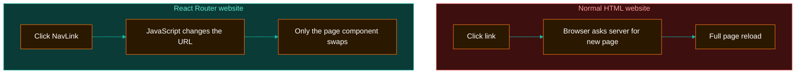

<div align="center">


<br/>


</div>

---

## 🧡 About This Task

Hey! Main **Anurag Prajapati** hoon 👋

Ye **Task 15** hai meri React learning journey ka. Isme maine **React Router** se ek **multi-page website** banayi hai: **Home**, **About** aur **Blog**. Pages ke beech jaane par **browser reload nahi hota**, sirf screen ka content badalta hai. Isi ko **Client Side Routing** kehte hain.

> 🧡 *"Ek HTML page, kai React pages."* — Anurag

---

## 📑 Table of Contents

- [Features](#-features)
- [Routes Table](#-routes-table)
- [Component Structure](#-component-structure)
- [How Routing Works](#-how-routing-works)
- [Code Highlights](#-code-highlights)
- [Folder Structure](#-folder-structure)
- [How to Run](#-how-to-run)
- [Concepts Used](#-concepts-used)
- [What I Learned](#-what-i-learned)
- [Future Improvements](#-future-improvements)
- [About the Author](#-about-the-author)

---

## ✨ Features

| | Feature | Detail |
|:-:|:--------|:-------|
| 🧭 | **Navbar** | Logo aur 3 links: Home, About, Blog |
| 📄 | **3 Pages** | Home, About aur Blog alag components me |
| ⚡ | **No Page Reload** | Page badalne par browser refresh nahi hota |
| 🎯 | **Active Link Highlight** | `NavLink` current page ke link ko apne aap `active` class deta hai |
| 🔗 | **Clean URLs** | `/`, `/about`, `/blog` |
| 📰 | **Blog Cards** | Blog page par 2 blog cards |
| 🦶 | **Common Footer** | Har page par same footer |
| 🧩 | **Reusable Layout** | Navbar aur footer ek baar likhe, har page par dikhte hain |

---

## 🗺️ Routes Table

| URL | Component | File | Page |
|:----|:----------|:-----|:-----|
| `/` | `Home` | `Home.jsx` | 🏠 Welcome page |
| `/about` | `About` | `About.jsx` | ℹ️ About Us page |
| `/blog` | `Blog` | `Blog.jsx` | 📰 Blog page with 2 cards |

---

## 🧩 Component Structure



---

## 🔄 How Routing Works

### 1️⃣ Link Click Se Page Badalne Tak



### 2️⃣ Sequence Diagram



### 3️⃣ Normal Website vs React Router



---

## 💡 Code Highlights

### 🌐 BrowserRouter Se Poori App Ko Wrap Karna

```jsx
// main.jsx
ReactDOM.createRoot(document.getElementById("root")).render(
    <React.StrictMode>
        <BrowserRouter>
            <App />
        </BrowserRouter>
    </React.StrictMode>
);
```

### 🧭 NavLink (Active Class Apne Aap Lagti Hai)

```jsx
<NavLink to="/" end>Home</NavLink>
<NavLink to="/about">About</NavLink>
<NavLink to="/blog">Blog</NavLink>
```

> 💡 `end` isliye lagaya, kyunki `/` har URL ka hissa hai. `end` ke bina Home link hamesha active dikhta.

### 🛣️ Routes Aur Route

```jsx
<Routes>
    <Route path="/" element={<Home />} />
    <Route path="/about" element={<About />} />
    <Route path="/blog" element={<Blog />} />
</Routes>
```

### 🎨 Active Link Ko Style Karne Ke Liye (CSS)

```css
.nav-links a.active {
    color: #ff7a18;
}
```

---

## 📂 Folder Structure

```bash
📦 task-15-react-router
 ┣ 📂 src
 ┃ ┣ 📜 main.jsx     # ⚛️ BrowserRouter yahan laga hai
 ┃ ┣ 📜 App.jsx      # 🧭 Navbar + Routes + Footer
 ┃ ┣ 📜 Home.jsx     # 🏠 Home page
 ┃ ┣ 📜 About.jsx    # ℹ️ About page
 ┃ ┣ 📜 Blog.jsx     # 📰 Blog page
 ┃ ┗ 📜 App.css      # 🎨 Styling
 ┣ 📜 index.html
 ┣ 📜 package.json
 ┗ 📜 README.md      # 📖 You are here
```

---

## 🚀 How to Run

```bash
# 1. Repository clone karo
git clone https://github.com/YOUR_USERNAME/YOUR_REPO_NAME.git

# 2. Project folder me jao
cd task-15-react-router

# 3. Dependencies install karo
npm install

# 4. Agar react-router-dom install na ho
npm install react-router-dom

# 5. Project chalao
npm run dev
```

Terminal me jo link aaye (jaise `http://localhost:5173`), use browser me open karo. 🎉

---

## 🧠 Concepts Used

| Concept | Kahan use hua |
|:--------|:--------------|
| Client Side Routing | Bina reload ke pages badalna |
| `BrowserRouter` | `main.jsx` me poori app ko wrap karta hai |
| `Routes` aur `Route` | URL ke hisaab se component chunna |
| `NavLink` | Navbar links aur active class |
| `path` aur `element` | Route ka URL aur dikhne wala component |
| `end` prop | Home link ko sirf `/` par active rakhna |
| Components | Home, About, Blog, App alag components |
| Layout Sharing | Navbar aur footer har page par same |
| JSX | HTML jaisa code JavaScript ke andar |
| Import / Export | `export default` aur `import` |

---

## 📚 What I Learned

- 🧭 **Client side routing** kya hota hai aur normal website se kaise alag hai
- 🌐 **`BrowserRouter`** poori app ko URL ki jaankari deta hai
- 🛣️ **`Routes` aur `Route`** se URL ko component se jodte hain
- 🎯 **`NavLink`** me `active` class apne aap lagti hai
- 🔚 **`end` prop** ki zaroorat kyun padti hai
- 🧩 Navbar aur footer ek baar likhkar **har page par** dikhana
- 📁 Har page ke liye **alag component file** banana

---

## 🔮 Future Improvements

- [ ] 🚫 **404 Not Found** page (`path="*"`)
- [ ] 🔀 `Link` aur `useNavigate` se button se navigation
- [ ] 🆔 Dynamic route jaise `/blog/:id` aur `useParams`
- [ ] 🧱 Nested routes aur `Outlet` se common layout
- [ ] 🔒 Protected routes (login ke baad hi page dikhe)
- [ ] ⏳ Page badalte waqt loading animation
- [ ] 🌙 Dark / Light mode

---

## 👨‍💻 About the Author

<div align="center">


**Anurag Prajapati**

> 🧡 Passionate beginner developer jo React aur modern web development seekh raha hai.

[](https://github.com/YOUR_USERNAME)
[](https://linkedin.com/in/YOUR_LINKEDIN)
[](mailto:YOUR_EMAIL@gmail.com)

</div>

---

## ⭐ Show Your Support

- ⭐ Repository ko **Star** karo
- 🍴 **Fork** karke apna version banao
- 📢 Doston ke saath **share** karo

---

<div align="center">

**Designed with 🧡 by [Anurag Prajapati](https://github.com/YOUR_USERNAME)**


</div>
