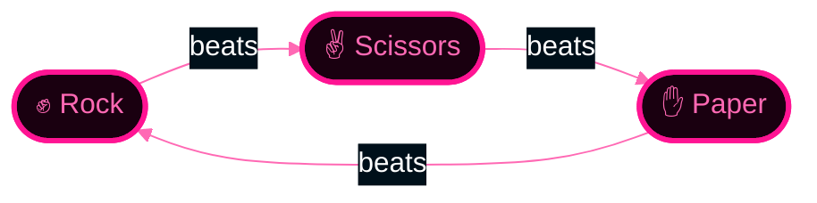
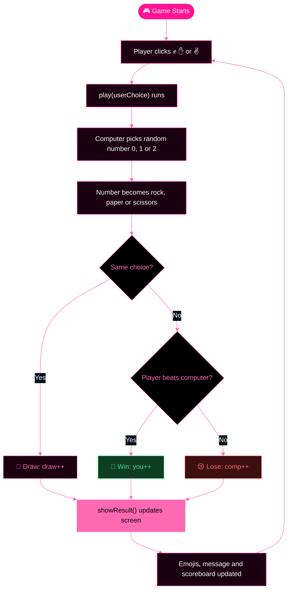
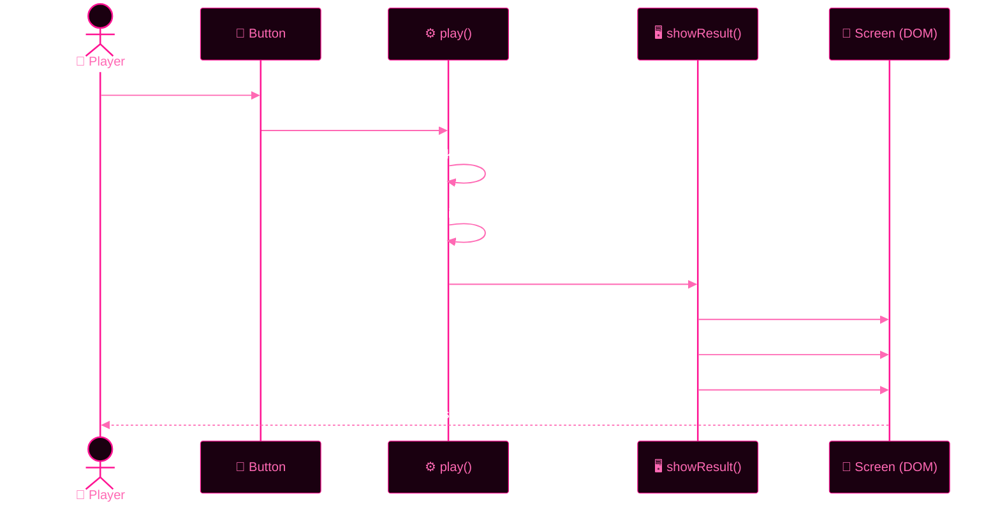
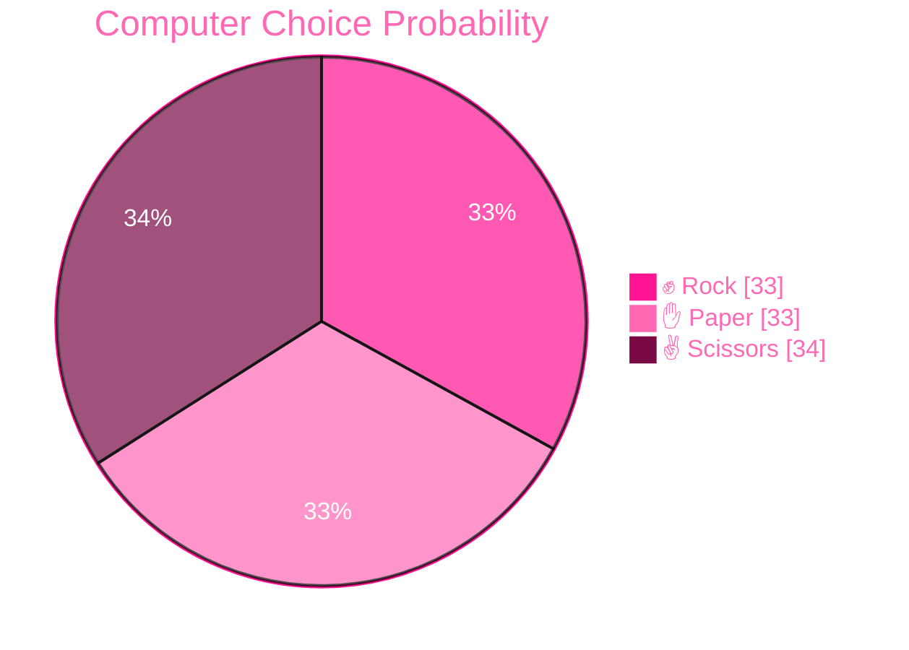
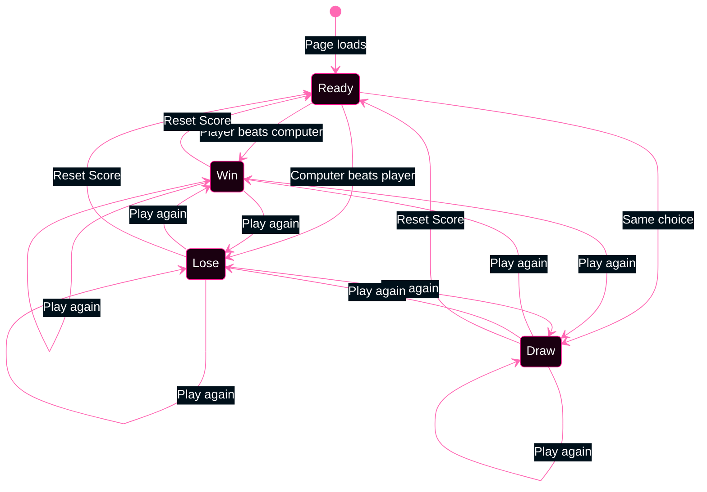

<div align="center">


<br/>


<br/>

### ✊ &nbsp;&nbsp; ✋ &nbsp;&nbsp; ✌️

</div>

---

## 💗 About The Game

Hey! Main **Anurag Prajapati** hoon 👋

**Rock Paper Scissors** ek classic game hai jo maine **sirf HTML, CSS aur JavaScript** se banaya hai, bina kisi framework ya library ke. Aap computer ke against khelte ho, computer **random choice** karta hai, aur result **Win 🎉 / Lose 😢 / Draw 🤝** ke roop me scoreboard par live dikhta hai.

> 🖤 *"Simple game, powerful concepts."* — Anurag

---

## 📑 Table of Contents

- [Preview](#-preview)
- [Features](#-features)
- [Game Rules](#-game-rules)
- [How The Game Works](#-how-the-game-works)
- [Code Highlights](#-code-highlights)
- [Folder Structure](#-folder-structure)
- [How to Run](#-how-to-run)
- [Tech Stack](#-tech-stack)
- [Concepts Used](#-concepts-used)
- [What I Learned](#-what-i-learned)
- [Future Improvements](#-future-improvements)
- [About the Author](#-about-the-author)

---

## 🎬 Preview

Game ka layout kuch aisa dikhta hai:

```text
┌──────────────────────────────────────┐
│            ✊  ✋  ✌️                  │
│        ROCK PAPER SCISSORS           │
│        PLAY AGAINST COMPUTER         │
│                                      │
│   ┌───────┐  ┌───────┐  ┌─────────┐  │
│   │  YOU  │  │ DRAW  │  │COMPUTER │  │
│   │   3   │  │   1   │  │    2    │  │
│   └───────┘  └───────┘  └─────────┘  │
│                                      │
│      ✋   VS   ✊                      │
│     YOU       COMPUTER               │
│                                      │
│          You Win! 🎉                 │
│                                      │
│       (✊)    (✋)    (✌️)            │
│                                      │
│          [ Reset Score ]             │
│       Created by Anurag 💗           │
└──────────────────────────────────────┘
```

> 📸 **Tip:** Apna asli screenshot lekar `screenshot.png` naam se is folder me daalo, phir niche wali line se README me dikha sakte ho:
> ``

---

## ✨ Features

| | Feature | Detail |
|:-:|:--------|:-------|
| 🎮 | **Play vs Computer** | Computer har baar random choice karta hai |
| 📊 | **Live Scoreboard** | YOU, DRAW aur COMPUTER ka score alag-alag |
| 🎯 | **Instant Result** | Win, Lose ya Draw message turant dikhta hai |
| 🎨 | **Color-coded Result** | Jeet = 💚 hara, Haar = ❤️ laal, Draw = 💗 pink |
| ✨ | **Pop Animation** | Har round me emojis halka sa pop hote hain |
| 💡 | **Neon Glow UI** | Pink glowing card, buttons aur scoreboard |
| 🖱️ | **Hover Effects** | Button par mouse le jao to bada hoke glow karta hai |
| 🔄 | **Reset Button** | Ek click me poora score zero |
| 📱 | **Responsive** | Mobile aur desktop dono par sahi dikhta hai |
| 🪶 | **Lightweight** | Sirf ek `.html` file, koi library ya internet nahi chahiye |

---

## 📜 Game Rules



| Aap ✔️ | Computer 🤖 | Result |
|:------:|:-----------:|:------:|
| ✊ Rock | ✌️ Scissors | 🎉 **You Win** |
| ✋ Paper | ✊ Rock | 🎉 **You Win** |
| ✌️ Scissors | ✋ Paper | 🎉 **You Win** |
| ✊ Rock | ✋ Paper | 😢 **You Lose** |
| ✋ Paper | ✌️ Scissors | 😢 **You Lose** |
| ✌️ Scissors | ✊ Rock | 😢 **You Lose** |
| Same choice | Same choice | 🤝 **Draw** |

---

## 🔄 How The Game Works

### 1️⃣ Poora Game Flow



### 2️⃣ Click Se Result Tak (Sequence)



### 3️⃣ Computer Ka Choice Fair Hai (1/3 Chance)



### 4️⃣ Game States



---

## 💡 Code Highlights

### 🎲 Computer Ka Random Choice

```javascript
let randomNumber = Math.floor(Math.random() * 3);   // 0, 1 ya 2
let compChoice = choices[randomNumber];             // rock, paper ya scissors
```

### 🏆 Jeetne Ke Rules

```javascript
if (userChoice === compChoice) {
    result = "draw";
    draw++;
}
else if (
    (userChoice === "rock" && compChoice === "scissors") ||
    (userChoice === "paper" && compChoice === "rock") ||
    (userChoice === "scissors" && compChoice === "paper")
) {
    result = "win";
    you++;
}
else {
    result = "lose";
    comp++;
}
```

### 🎨 CSS Variables (Poori Theme Ek Jagah Se)

```css
:root {
    --bg: #000000;
    --card: #151515;
    --pink: #ff1493;
    --pink-light: #ff69b4;
}
```

### ✨ Neon Glow Effect

```css
.game {
    border: 1px solid var(--pink);
    box-shadow: 0 0 25px rgba(255, 20, 147, 0.4);
}
```

---

## 📂 Folder Structure

```bash
📦 rock-paper-scissors
 ┣ 📜 rock-paper-scissors.html   # 🎮 Poora game (HTML + CSS + JS)
 ┗ 📜 README.md                  # 📖 You are here
```

---

## 🚀 How to Run

**Option 1: Direct (Sabse easy)**

1. Repository **download** ya **clone** karo
2. `rock-paper-scissors.html` par **double-click** karo
3. Browser me game khul jayega, bas khelo! 🎉

**Option 2: Git Clone**

```bash
git clone https://github.com/YOUR_USERNAME/rock-paper-scissors.git
cd rock-paper-scissors
```

Phir `rock-paper-scissors.html` ko browser me open karo.

**Option 3: VS Code Live Server**

1. VS Code me folder open karo
2. **Live Server** extension install karo
3. File par right-click → **Open with Live Server**

**Option 4: GitHub Pages (Online Game Link)** 🌐

1. Repo ki file ka naam `index.html` rakh do
2. **Settings → Pages** me jao
3. Branch **main** chuno aur **Save** karo
4. Kuch minute baad game ka live link mil jayega:
   `https://YOUR_USERNAME.github.io/rock-paper-scissors/`

---

## 🛠️ Tech Stack

<div align="center">

| Technology | Use |
|:----------:|:----|
|  | Game ka structure (buttons, scoreboard, arena) |
|  | Neon design, Flexbox, Grid, animations |
|  | Game logic, random choice, score update |

</div>

---

## 🧠 Concepts Used

| Concept | Kahan use hua |
|:--------|:--------------|
| `Math.random()` aur `Math.floor()` | Computer ka random choice |
| Arrays | `choices = ["rock", "paper", "scissors"]` |
| Objects | `emoji = { rock: "✊", ... }` |
| `if / else if / else` | Win, Lose, Draw decide karna |
| `&&` aur `\|\|` operators | Jeetne ke rules jodna |
| Functions | `play()`, `showResult()`, `resetGame()` |
| DOM Manipulation | `getElementById`, `innerText`, `classList` |
| Events | `onclick` se button click pakadna |
| CSS Variables | Poori theme ek jagah se control |
| Flexbox aur Grid | Layout aur scoreboard |
| `box-shadow` aur `text-shadow` | Neon glow effect |
| `transition` aur `@keyframes` | Hover aur pop animation |

---

## 📚 What I Learned

- 🎯 **Event handling**: button click par function chalana
- 🎲 **Random numbers**: `Math.random()` se fair choice banana
- 🧩 **Logic building**: win, lose aur draw ke rules code me likhna
- 🖥️ **DOM manipulation**: JavaScript se screen ka text aur color badalna
- 🎨 **CSS design**: gradients, glow effect, animations, CSS variables
- 🔁 **Reflow trick**: `offsetWidth` se animation dobara chalana
- 🐛 **Thinking in edge cases**: draw, reset aur baar-baar click

---

## 🔮 Future Improvements

- [ ] 🏅 Best of 5 round mode
- [ ] 💾 Score ko `localStorage` me save karna
- [ ] 🔊 Click aur win/lose sound effects
- [ ] ⌨️ Keyboard keys (R, P, S) se khelna
- [ ] 🧠 Smart computer jo pattern pakde
- [ ] 🦎 Rock Paper Scissors **Lizard Spock** mode
- [ ] 🌙 Dark / Light theme toggle
- [ ] 🏆 High score tracker

---

## 👨‍💻 About the Author

<div align="center">


**Anurag Prajapati**

> 💗 Passionate beginner developer jo HTML, CSS aur JavaScript se creative projects aur games banana pasand karta hai.

[](https://github.com/YOUR_USERNAME)
[](https://linkedin.com/in/YOUR_LINKEDIN)
[](mailto:YOUR_EMAIL@gmail.com)

</div>

---

## ⭐ Show Your Support

Agar ye game pasand aaya to:

- ⭐ Repository ko **Star** karo
- 🍴 **Fork** karke apna version banao
- 📢 Doston ke saath **share** karo aur unhe haraao 😎

---

<div align="center">

**Made with 💗 and ☕ by [Anurag Prajapati](https://github.com/YOUR_USERNAME)**


</div>
